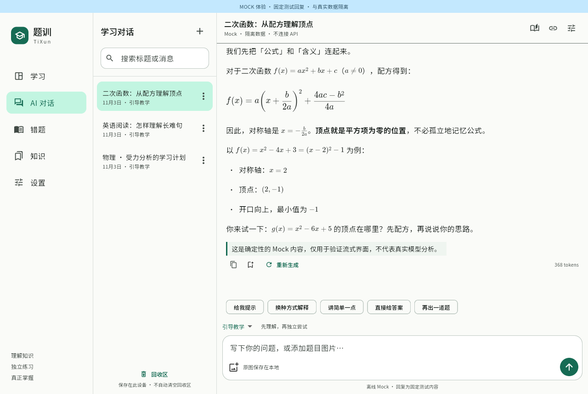
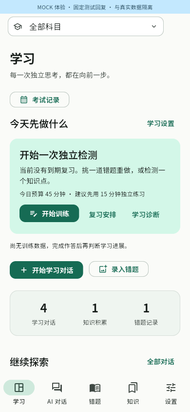
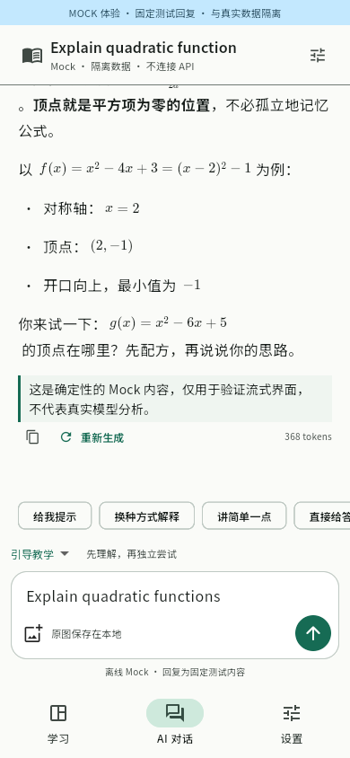
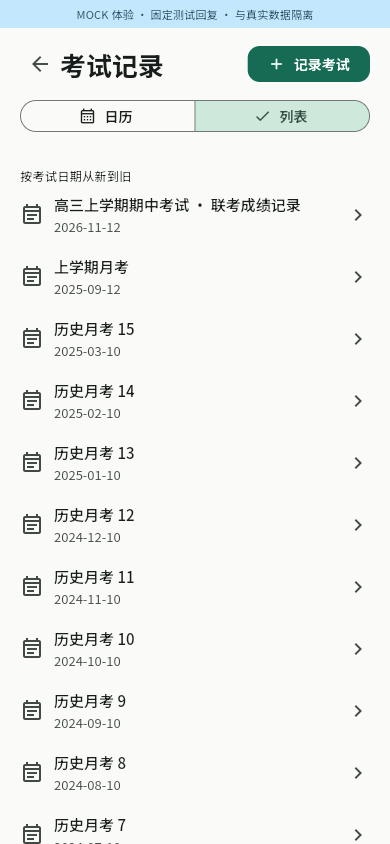

# TiXun

English · [简体中文](README.md)

**Understand a question. Practise until you can solve it yourself.**

TiXun is an open-source learning app for Android and Linux. Ask AI for help, keep knowledge notes and mistakes, then check your understanding with independent practice and spaced review.

No TiXun account is required. Learning data stays on your device, and saved material and existing exercises work offline. AI needs an internet connection and either your provider's API key or an eligible ChatGPT account signed in through the app.

## Download

- Download the [latest stable release](https://github.com/mumu-lhl/tixun/releases/latest).
- To try subsequent changes, use the [latest Nightly](https://github.com/mumu-lhl/tixun/releases?q=nightly&expanded=true).

Linux needs GTK 3, bubblewrap, and a kernel that permits unprivileged user namespaces; Python refuses to run if isolation is unavailable. Credentials also require an unlocked Secret Service keyring such as GNOME Keyring. Missing secure storage is reported; keys are not silently saved as plain text. Run `chmod u+x tixun` if needed.

## Preview and contribute

These screenshots show actual runs in isolated Mock mode, using fixed replies rather than real model results.

 

[Report an issue](https://github.com/mumu-lhl/tixun/issues) with your platform and reproduction steps; do not share credentials or private material.

Code is [MIT licensed](LICENSE); bundled fonts use the OFL license.
