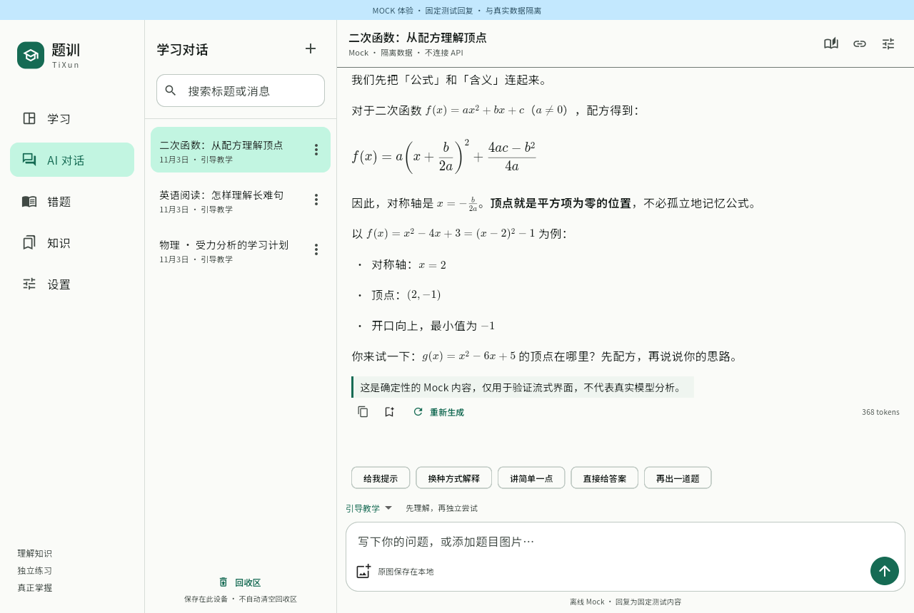
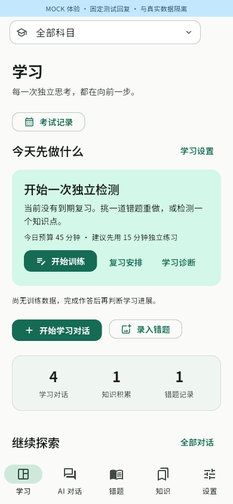
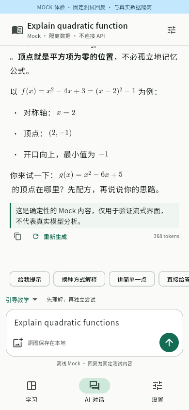

# TiXun

English · [简体中文](README.md)

**Understand a question. Practise until you can solve it yourself.**

TiXun is an open-source learning app for Android and Linux. Ask AI for help, keep knowledge notes and mistakes, then check your understanding with independent practice and spaced review.

No TiXun account is required. Learning data stays on your device, and saved material and existing exercises work offline. AI needs an internet connection and either your provider's API key or an eligible ChatGPT account signed in through the app.

## Download

Use the [latest Nightly](https://github.com/mumu-lhl/tixun/releases?q=nightly&expanded=true) for recent features. This README describes the current main branch; recent changes are delivered through Nightly and may still need further validation. The older [stable v0.5.2](https://github.com/mumu-lhl/tixun/releases/latest) remains available but does not include all of them.

Choose a file under **Assets**:

| Platform | File name contains | Instructions |
| --- | --- | --- |
| Android 10+, most modern phones | `android-arm64-v8a-release.apk` | Download and install the APK. |
| Android, unsure of architecture | `android-universal-release.apk` | Includes all supported architectures; larger download. |
| Other Android architectures | `armeabi-v7a` or `x86_64` APK | For compatible 32-bit devices or x86_64 devices/emulators. |
| Linux x86_64 | `linux-x64.tar.gz` | Extract and run `./tixun`. Keep the adjacent `lib` and `data` folders. |

Published packages use **Release mode**. Current Nightly APKs share the same release signing key; `SHA256SUMS` provides download checksums. v0.5.2 uses an older development key: export a full backup before uninstalling it, then install the new version and restore your data.

Linux needs GTK 3 and, for credentials, an unlocked Secret Service keyring such as GNOME Keyring. Missing secure storage is reported; keys are not silently saved as plain text. Run `chmod u+x tixun` if needed.

Nightly builds start daily at 20:30 UTC, subject to GitHub scheduling and successful verification. Only the latest successful Nightly release, assets and tag are retained. Stable releases are preserved.

## Start learning

Open **Settings → Models and connections** and choose:

- **DeepSeek:** save your API key and test the connection. Flash supports images; V4 Pro is text-only.
- **OpenAI-compatible:** configure the URL, model ID, key and actual model capabilities.
- **ChatGPT:** open the plan sign-in page from model settings and choose **Continue with ChatGPT**. Authorize in your browser, then select your account and model. Available models and allowance depend on your account's permissions. Requests do not automatically fall back to API billing. [Integration details](docs/CHATGPT_PROVIDER.md).

A connection test sends a short request and may consume provider usage. Without AI configured, you can still organize material and practise existing questions.

Start a conversation from Study. Guided teaching offers hints and invites you to try; Direct answer provides a full explanation. Exam mode lets you answer before showing feedback. Replies stream, and interactive question cards save actual answers. AI-generated reference answers remain unverified until checked.

An AI reply’s save menu can organize it into knowledge or a mistake, or merge it into an existing note you select. Review the process in a separate chat and confirm each write. Knowledge also has AI create and edit actions; edits preserve revision history.

On phones, the chat's more menu contains material tools, linked material and model settings. Enable material tools to let AI search notes or propose changes. Application permissions and confirmation still apply. DeepSeek and ChatGPT support reasoning with tools; compatible services follow their declared capabilities.

## Photos and study material

Android provides WeChat-style capture and gallery previews with multiple selection, plus image files. The capture screen also offers a system-camera fallback. Linux uses file selection. Imported photos open an editor for cropping, rotating and zooming. Save uses the edited result; closing retains the uncropped photo. Originals are preserved in chat, knowledge, mistakes and exam records. Tap a thumbnail for fullscreen viewing.

There is no fixed business limit on image count. Each image is limited to **8 MB**, with additional pixel and decoding safeguards in the editor. Model capability, context budget and request-size limits still apply.

Choose your subjects under Settings → Study subjects, including custom subjects. Switch the current subject at the top of Study. Knowledge and Mistakes share a two-level subject directory; records can belong to multiple modules. Parent filters include submodules. Removing a directory entry keeps your study material.

In Settings → Learning goals, optionally add your stage (such as final-year high school), region, target exam and scope. AI uses these as background for explanations and practice, without assuming an exact local syllabus.

From saved notes and mistakes, request explanations, targeted practice or reviews. AI can propose directory entries and associations, subject to confirmation.

## Exams, review and scratchpads

Open Exam records from Study, choose a calendar date and add subjects. Chinese, mathematics and English use raw scores only; other subjects may also record scaled scores. Unknown marks can stay blank.

Keep papers, answer sheets and reference answers separately. The score breakdown supports questions and subquestions, with quick next-entry actions. Child scores determine parent totals; the breakdown does not overwrite the raw score. AI extraction sends only selected photos, up to 20 MB combined, to a vision model. Review suggestions before saving, which replaces the previous breakdown. Mock mode does not pretend to grade real photos.

Review dates use actual answers, hint use and answer verification. Reading a solution does not count as mastery. Reminders currently appear in the app, without background system notifications.

Chat sessions, mistakes and practice questions have multi-page scratchpads. Use colored pens, adjustable widths, a radius eraser, undo/redo and pan/zoom on an unbounded canvas. Reset view preserves ink. Pages and view positions save locally; undo history lasts for the current opening. Drafts are not automatically sent to AI.

## Make it yours

Settings provides Chinese/English, system language, light/dark themes and dynamic colors. Android 12+ wallpaper colors and supported Linux desktop accents fall back to the default palette when unavailable.

Set a global reasoning effort or override it for a conversation or exam extraction. Choices follow model capabilities: `xhigh` and `max` are distinct, as are Model default and explicit `none`. Returned reasoning or public summaries can be expanded and copied; internal encrypted state is not displayed. Exercise reasoning stays hidden until submission.

Prompt management supports searching, editing, previewing and resetting teaching and task prompts. Changes affect future requests, without bypassing permissions or rewriting history. Long conversations use a configurable context-token budget and summaries of older turns. Full history stays local; summarization may consume additional model usage.

## Updates, backups and privacy

At the bottom of Settings, select Stable, Prerelease or Nightly and check for updates. Automatic startup checks are at least six hours apart and do not block learning; manual checks are not throttled by that interval. Downloads are checked before installation. Android chooses an appropriate APK and opens the system installer; Linux stages an update for restart. Manual downloads remain available.

Export a full backup under Settings → Backup and restore before uninstalling or changing devices. It includes chats, notes, mistakes, photos, exams, practice, reviews and scratchpads, but **not API keys or ChatGPT tokens**. Restore replaces current learning data and retains a copy for undoing the last restore. Deleted notes and mistakes can be recovered from Trash until permanently removed.

AI receives only the context, images and selected material needed for the request, not your entire library by default. Update checks access GitHub release information without uploading learning data. No behavior analytics are enabled by default. Check important answers: AI explanations and generated questions can be wrong.

## Preview and contribute

These screenshots were captured on 2026-11-10 in isolated Mock mode, using fixed replies rather than real model results.

 

[Report an issue](https://github.com/mumu-lhl/tixun/issues) with your platform and reproduction steps; do not share credentials or private material. See the [development guide](DEVELOPMENT.md), [design](DESIGN.md) and [status](ROADMAP.md).

Physical Android camera/permission checks and real AI/ChatGPT account acceptance still require separate validation. Mock and protocol tests do not replace them.

Code is [MIT licensed](LICENSE); bundled fonts use the OFL license.
