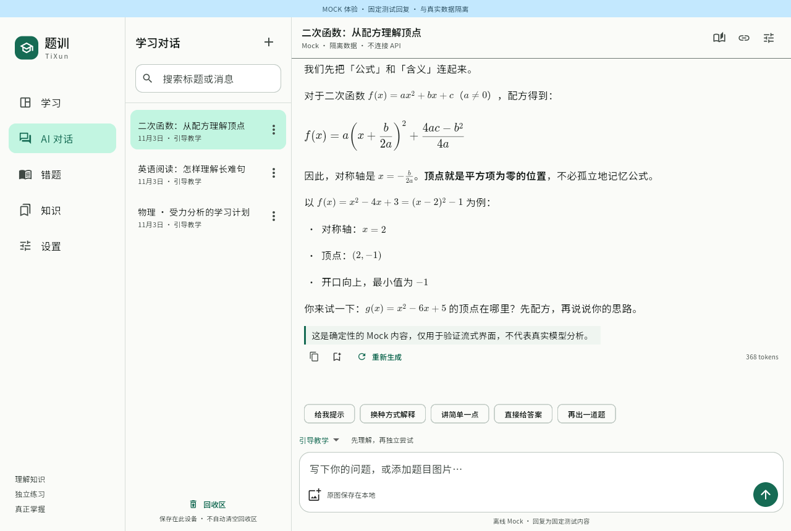
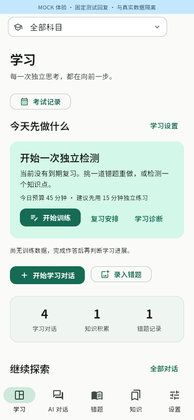
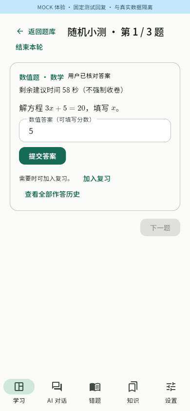
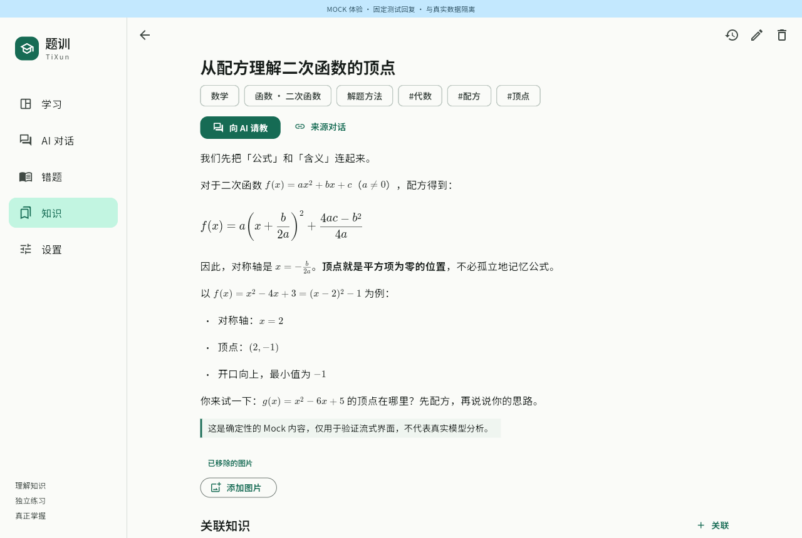

# 题训 TiXun

[English](README.en.md) · 简体中文

**把不懂的题，练到自己会做。**

题训是一款面向 Android 和 Linux 的开源学习应用。你可以向 AI 请教，整理知识和错题，再通过独立作答与间隔复习检查自己是否真正掌握。

无需注册题训账号，学习资料保存在自己的设备上。已有资料和练习可以离线使用；使用 AI 时，需要联网并填写自己的 API Key。

[下载安装](#下载安装) · [开始使用](#开始使用) · [界面预览](#界面预览) · [反馈问题](https://github.com/mumu-lhl/tixun/issues)

## 题训能帮你做什么？

- **弄懂一道题。** 输入问题或添加题目图片，让 AI 直接讲解，或一步步给提示。遇到难懂的解释，可以让它换种方式、讲简单一点。
- **留下自己的理解。** 把对话中的知识保存下来，按科目、章节和标签整理；记下公式、方法，也可以写成自由笔记。
- **整理错题。** 保存原题图片、自己的答案、解析和错误原因。整张试卷可以手动框选分题，也可以先让 AI 建议范围，再逐题检查和保存。
- **合上解析，再试一次。** 重做错题、检测知识点，或让 AI 出一道变式题。选择题可以直接点击作答，提交后查看反馈；已有题目也能组成离线随机小测，未完成时可以暂停续做。
- **知道接下来复习什么。** 根据实际作答安排复习，在学习首页查看到期任务和近期表现。数据不足时会明确提示，方便你判断还需要哪些练习。

数学公式、中文长文、图片和深浅色主题都有对应支持。最初面向高中学习，也允许自行设置科目、学习阶段和目标考试。

## 下载安装

当前版本为 **0.5.2**，支持 Android 10 及以上版本，以及 Linux 桌面。

前往 **[GitHub Releases](https://github.com/mumu-lhl/tixun/releases/latest)**，在 **Assets** 中下载对应平台的文件，无需登录 GitHub：

| 使用平台 | 下载文件 | 如何启动 |
| --- | --- | --- |
| Android | `tixun-v版本号-android-release.apk` | 将 APK 传到手机上安装。系统询问时，允许当前下载或文件管理应用安装此 APK。 |
| Linux（x86_64） | `tixun-v版本号-linux-x64.tar.gz` | 解压后运行其中的 `tixun`，保留同目录的 `lib`、`data` 等文件，不要只复制可执行文件。 |

发布附件均使用 Release 模式构建。Android 目前采用开发签名，更换签名时可能无法直接覆盖安装；卸载前请先导出学习资料备份。`SHA256SUMS` 可用于校验下载文件。

Linux 解压后，在 `tixun` 所在文件夹打开终端，赋予运行权限并启动：

```bash
chmod u+x tixun
./tixun
```

Linux 需要 GTK 3 等运行库。保存 API Key 还需要已解锁的系统密钥环，例如 GNOME Keyring；密钥环不可用时，应用不会改为明文保存密钥，本地资料仍可使用。

目前提供的是开发包，尚未正式上架应用商店。构建和自动化测试已通过；真实 DeepSeek 调用及 Android 实机体验仍待验收，详细状态见[开发进度](ROADMAP.md)。

## 开始使用

### 1. 配置 AI

打开「设置」，选择 AI 服务，填写自己的 API Key，点击「保存配置」，再用「测试连接」检查是否可用。

默认使用 DeepSeek，无需修改默认地址和模型。**DeepSeek Flash 支持图片，DeepSeek V4 Pro 仅支持文字。** 也可以选择兼容服务，填写对应的接口地址、模型名称和密钥。

API Key 需要向所选服务商申请，模型调用由服务商计费；测试连接也会发送一条简短消息，可能产生少量费用。不配置 AI，也可以先手动整理资料和练习已有题目。

主分支还提供以下设置（尚未包含在 v0.5.2 下载包中）：

- **语言与外观**：在「设置 → 外观」切换中文、English 或跟随系统，也可开关动态配色。Android 12 及以上可使用壁纸色，Linux 可使用桌面强调色；系统不提供颜色时沿用默认配色。
- **思考强度**：设置中选择全局默认；聊天顶部的思考按钮可单独调整当前会话。知识讲解、错题分析和出题都进入同一个聊天入口，可以在那里调整。当前交互出题、分题和资料工具使用非思考模式，应用会明确提示；不会更改全局默认。
- **提示词管理**：在「设置 → 提示词管理」编辑通用教学风格，以及引导教学、直接解答、考试、知识、错题、练习、变式和分题提示词。支持搜索、预览和恢复默认。修改用于后续请求，不改写已有聊天；切换语言也不会翻译你的自定义内容。

ChatGPT Plus/Pro 订阅不能直接填入 API Key 一栏。官方已提供适合开源本地应用的订阅授权方式，题训**尚未接入该登录流程**；当前 OpenAI-compatible 仍使用服务商 API Key。[接入说明](docs/CHATGPT_PROVIDER.md)

### 2. 从一个问题开始

在「学习」页点击「开始学习对话」，输入问题或添加图片。默认的「引导教学」会尽量留下让你自己思考的空间；想看完整步骤时，可以切换到「直接解答」，或直接说“给我完整解析”。

图片发送前可以预览、裁剪和旋转，原图会保留。一次最多添加 4 张图片，每张不超过 8 MB。

### 3. 保存，再练习

弄懂之后，通过消息菜单把知识或题目保存到知识库、错题本。之后可以从资料详情继续向 AI 请教，也可以合上解析重做。

例如，你可以这样开始一轮学习：

1. 上传一道做错的题，告诉 AI 自己卡在哪一步。
2. 按提示重新推导，把关键方法保存下来。
3. 独立完成一道检测题或变式题，再查看反馈。
4. 之后从学习首页进入到期复习，检查自己是否还会做。

AI 生成的题目会标记为“参考答案待核对”。即使作答与参考答案一致，也不代表题目一定正确；简答题和错题重做还可以由你自己判分。

### 让 AI 帮你整理资料

在对话标题栏开启「资料工具」后，可以说：“查找我保存的配方法笔记”或“总结刚才的知识点并保存”。AI 才能读取相关学习资料，新增、修改、删除和关联操作都需要你确认。

当前在聊天中生成可作答题目、使用资料工具和建议分题，需要关闭「深度思考」。也可以随时通过知识库、错题本的独立页面手动操作。

## 数据由你保管

对话、知识、错题、图片和作答记录默认保存在本地，不自动云同步，也不加入第三方行为分析。使用 AI 时，会向你选择的服务商发送当前请求所需的对话、图片或资料；不会默认上传整个知识库。

API Key 保存在系统安全存储中，不写入学习数据库，也不包含在导出的备份里。

建议定期在「设置 → 备份与恢复」中导出完整备份，尤其是在卸载应用、更换设备之前。备份包括对话、资料、图片、训练和复习记录；换设备后需要重新配置 API Key。

恢复备份会替换当前学习数据。题训会保留最近一次恢复前的数据，供你撤销恢复；不再需要时，也可以单独删除这份安全副本。

学习资料误删后可到回收区恢复，回收区不会自动清空。永久删除需要确认，但不会同时删除你已导出到其他位置的备份。

## 常见问题

**没有网络还能用吗？**

可以查看和编辑已有资料、浏览历史对话、练习已有题目，以及查看学习记录。生成 AI 回复、解析和新题目需要联网。

**为什么图片问答或聊天出题不可用？**

先检查所选模型是否支持图片或工具调用。DeepSeek V4 Pro 不支持图片；当前交互出题和资料工具需要关闭「深度思考」。自定义服务还需要正确设置模型能力。

**复习会发送系统通知吗？**

目前在应用内显示到期提醒，还没有后台系统通知。打开「学习」页或复习列表即可查看待办。

**电脑上有哪些快捷键？**

`Ctrl+N` 新建对话，`Ctrl+Enter` 发送，`Esc` 停止生成。`Ctrl+1` 至 `Ctrl+5` 分别打开学习、对话、设置、错题和知识页面。

## 界面预览

以下是应用的实际界面截图，使用独立的演示资料和固定 AI 回复，不代表真实模型的回答质量。



 



## 反馈与参与

使用中遇到问题，或有希望改进的学习体验，欢迎[提交反馈](https://github.com/mumu-lhl/tixun/issues)。描述使用平台、操作步骤和实际现象会更有帮助；请勿附上 API Key 或不希望公开的个人学习资料。

想参与开发，可以阅读[开发指南](DEVELOPMENT.md)、[设计说明](DESIGN.md)和[开发进度](ROADMAP.md)。

代码采用 [MIT 许可证](LICENSE)，随附字体采用 OFL 许可证。
