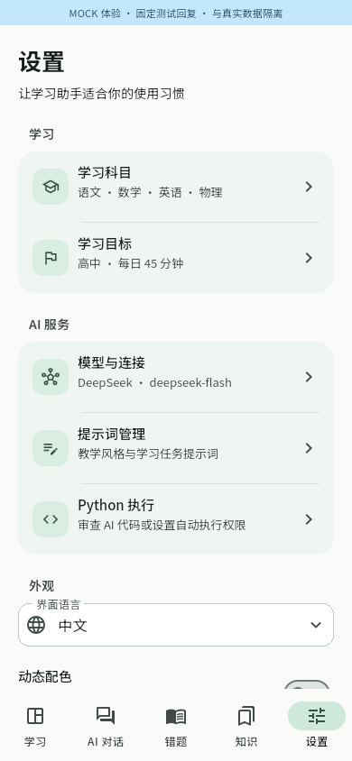
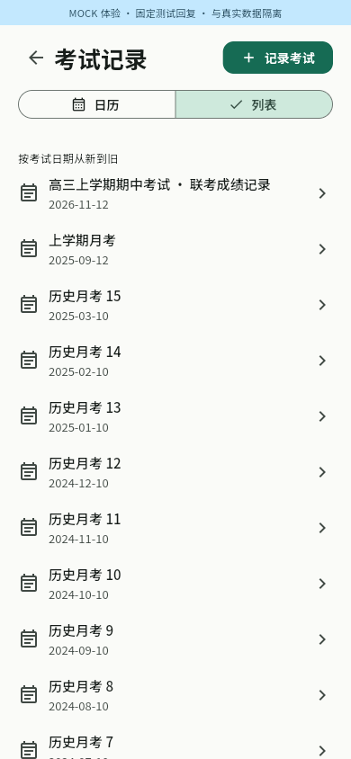

# 题训 TiXun

[English](README.en.md) · 简体中文

**把不懂的题，练到自己会做。**

题训是一款面向 Android 和 Linux 的开源学习应用。向 AI 请教，留下自己的知识笔记和错题，再通过独立作答与间隔复习，检查自己是否真正掌握。

无需注册题训账号。学习资料默认保存在设备上，已有资料和练习可以离线使用。AI 功能需要联网，使用自己的 API Key，或通过应用登录具有相应权限的 ChatGPT 账号。

[下载应用](#下载应用) · [开始学习](#开始学习) · [备份与隐私](#备份与隐私) · [反馈问题](https://github.com/mumu-lhl/tixun/issues)

## 下载应用

- **正式版：** 下载[最新正式版](https://github.com/mumu-lhl/tixun/releases/latest)。当前版本为 **v0.6.0**。
- **想体验后续改动：** 下载[最新 Nightly](https://github.com/mumu-lhl/tixun/releases?q=nightly&expanded=true)。Nightly 跟随主分支更新，可能包含尚未充分验证的改动。

安装包在 Releases 的 **Assets** 中，无需登录 GitHub。根据设备选择：

| 平台 | 选择的文件 | 使用方法 |
| --- | --- | --- |
| Android 10 及以上，大多数现代手机 | 名称含 `android-arm64-v8a-release.apk` | 下载 APK 后安装。 |
| Android，不确定架构 | 名称含 `android-universal-release.apk` | 包含全部支持的架构，文件较大。 |
| Android 其他架构 | `armeabi-v7a` 或 `x86_64` APK | 分别用于兼容的 32 位设备、x86_64 设备或模拟器。 |
| Linux x86_64 | 名称含 `linux-x64.tar.gz` | 解压后运行 `./tixun`，保留旁边的 `lib` 和 `data` 目录。 |

发布附件使用 **Release 模式**。v0.6.0 和当前 Nightly 的四种 APK 使用同一发布签名；`SHA256SUMS` 用于校验文件。v0.5.2 使用旧开发签名，首次换到新签名版本前，需先导出备份，再卸载旧版、安装并恢复资料。不要直接卸载未备份的应用。

Linux 需要 GTK 3 等运行库。保存密钥还需要已解锁的系统密钥环，例如 GNOME Keyring；不可用时会明确报错，不会改为明文保存。必要时在解压目录运行：

```bash
chmod u+x tixun
./tixun
```

Nightly 每天北京时间 04:30（UTC 20:30）开始构建，实际发布时间取决于 GitHub 排队和构建结果。仅保留最新一个成功发布的 Nightly；旧 Nightly 的 Release、附件和 Tag 会被清理，稳定版不受影响。

## 开始学习

### 连接 AI

打开「设置 → 模型与连接」，选择以下方式之一：

- **DeepSeek：** 填写自己的 API Key，保存后测试连接。默认 Flash 支持图片；V4 Pro 仅支持文字。
- **OpenAI-compatible：** 填写服务地址、模型 ID、API Key，并按服务商说明配置图片、工具和推理能力。
- **ChatGPT 订阅：** 从模型设置进入 ChatGPT 登录页，点击 **Continue with ChatGPT**，在系统浏览器完成授权后，选择账号和模型。无需另外填写 API Key；可用模型与额度取决于账号实际授权，不会在额度不足时自动转为 API 计费。[接入说明](docs/CHATGPT_PROVIDER.md)

测试连接会发送一条简短请求，可能消耗服务商用量。不配置 AI，也可以先手动整理资料、练习已有题目。

### 提问、尝试，再订正

从「学习」页开始对话，输入问题，或添加题目图片。默认的「引导教学」会给提示、邀请你尝试；需要完整步骤时，可切换「直接解答」，或直接说“给我完整解析”。「考试训练」则先让你答题，再展示反馈。

回复采用流式显示。AI 可以在聊天中生成可点击作答的题目，作答记录会实际保存。生成的参考答案仍需核对，答对一道未经核验的 AI 题目不等于已经掌握。

输入框支持换行，桌面可用 Ctrl+Enter 发送。向上查看历史时，停止滚动后会显示半透明的“回到最新消息”按钮；拖动和惯性滚动中隐藏。

AI 回复的保存菜单可让 AI 整理成知识或错题，也可搜索并选择已有知识进行合并。会打开独立对话供你查看整理过程，保存和修改前需要确认。知识页可直接「AI 生成知识」，详情页可「AI 编辑」；修改保留版本历史。

手机聊天顶部的更多菜单提供资料工具、关联资料和模型设置。资料工具可按知识、错题、科目目录、学习进度和复习安排分别开启，也可一键全部启用或关闭。选择会保存在当前会话中；关闭的类别不会提供给 AI，修改数据仍需要应用授权和确认。DeepSeek、ChatGPT 支持思考与工具共用，兼容服务则取决于其实际能力。

### 让 AI 使用 Python 辅助计算

在「设置 → Python 执行」选择权限。默认每次展示 AI 要运行的完整代码，由你选择是否允许运行；也可关闭，或明确开启自动允许。Chat、出题、错题解答和知识生成共用这一能力。手机 Chat 会隐藏底部导航栏，顶部返回按钮可返回上一页。

Python 运行时、NumPy、SymPy 和 mpmath 随应用打包，无需 Termux 或额外服务器。执行记录可展开查看代码、输出和错误；输出会发给当前模型以继续回答。

**这是任意 Python 代码执行，不是安全沙箱。** 代码拥有应用的文件和网络访问能力，可能损坏资料；自动允许会跳过审查。停止请求无法保证立即中断阻塞的原生代码或 I/O，必要时需重启应用。生成文件留在当前会话的 Python 工作目录，不自动加入知识、错题或备份。计算通过也不代表整道题的条件和推理已验证。

### 拍照、选图与裁剪

Android 使用微信风格的拍照与相册预览多选，也支持图片文件选择；拍照页可切换到系统相机。Linux 使用文件选择。添加照片后可框选、调整边角、旋转或缩放查看。保存会使用编辑结果，关闭编辑器则保留未裁剪的照片；多张照片逐张编辑。

聊天、知识、错题和考试照片都保留原图。点击缩略图可全屏查看；聊天草稿和考试照片可再次编辑，知识与错题还可单独框选分题。图片数量不设固定业务上限；**单张图片上限为 8 MB**，编辑器另有像素与解码尺寸保护。AI 请求仍受模型能力、上下文预算及接口大小限制。

### 用照片记录错题

错题页优先提供「导入照片」，Android 还可直接拍照。单张导入并裁剪后会打开该题；「文字录入」可补充纯文本题目，照片题不必先抄题。

在详情页选择「AI 分析错题」，检查带入对话的图片与内容后发送；需要自己推导时选择「引导我重做」。回复的保存菜单可将解析写回关联错题，只需核对解析内容，再点击保存，原题、图片和分类会保留。

### 知识与错题按目录整理

在「设置 → 学习科目」选择自己的科目，也能添加日语等自定义科目；学习页顶部可切换当前科目。

知识库和错题本共用科目目录。例如「数学 → 函数与导数 → 单调性与极值」。一条资料可以关联多个模块，按父模块查找时包含子模块。删除目录只移除分类关联，不删除学习资料。

保存笔记、题目、自己的答案和解析后，可以继续向 AI 请教、安排复习，或发起专项训练。AI 也可以提议添加目录和关联资料，需要你确认。

### 记录考试与小分

从学习页进入「考试记录」，可切换日历和从新到旧的列表。列表包含跨月份的考试，返回和记录入口固定在顶部；创建时可选择考试日期，再添加科目。语文、数学和英语仅记录裸分，其他科目可选择记录赋分；未知成绩可以留空。

试卷、答题卡和参考答案分别保存照片。小分表支持大题和小题，「下一题」「下一小题」会连续编号并聚焦得分；有小题的大题按小题汇总，明细不会自动覆盖裸分。

「AI 整理小分表」只发送选中的照片，需要支持图片的模型；照片合计不超过 20 MB。AI 优先读取已有批阅分数，缺少依据时留空。检查并修改建议后再保存，保存会替换原小分表。Mock 模式不会假装给真实照片评分。

### 复习与手写草稿

学习页提供到期复习、近期训练和薄弱点入口。复习时间根据真实作答、提示使用及答案核验情况调整，不因看过解析就标记掌握。目前提醒显示在应用内，没有后台系统通知。

聊天、错题和练习中都可打开草稿画板：多页、彩色画笔、粗细、范围橡皮、撤销重做，以及移动缩放。画布没有固定纸张边界；「回到原点」只重置视图。笔迹和视图自动保存，撤销重做历史限于本次打开期间，草稿不会自动上传 AI。

## 按自己的习惯设置

- **语言与外观：** 支持中文、English、跟随系统、深浅主题和动态配色。Android 12 及以上可使用壁纸色；Linux 支持可用的桌面强调色，缺失时使用默认配色。
- **思考强度：** 模型设置提供全局默认，聊天顶部可覆盖当前会话，考试小分整理也可单独设置。档位按模型能力显示，`xhigh` 与 `max` 不合并；“模型默认”与明确的 `none` 也不同。
- **思考面板：** 接口返回的思考内容或公开摘要可展开、收起和选择复制；不编造模型未返回的思考。出题和未提交的练习会隐藏可能泄露答案的内容。
- **学习目标：** 填写学习阶段（如高三）、地区（可选，如浙江）、目标考试和学习范围。AI 会在讲解、出题与资料整理时参考这些背景；地区不代表已核对当地考纲。[查看设置示例](docs/screenshots/learning-profile-phone.png)。
- **提示词管理：** 搜索、编辑、预览或恢复教学及各项学习任务的提示词。知识生成与整理、知识编辑与合并可分别配置。修改用于后续请求，不改写历史内容，也不能绕过工具权限和答题规则。
- **长对话：** 在模型设置中调整上下文 Token 预算。超出预算时会整理旧对话摘要，完整记录仍在本地；摘要可能增加模型用量，失败时使用近期内容并提示。

## 更新应用

「设置」底部提供正式版、预发布和 Nightly 通道，以及「检查更新」。启动时的自动检查间隔至少 6 小时，不阻塞学习；手动检查不受此间隔限制。

下载后会核对校验信息。Android 按设备架构选择 APK，并打开系统安装界面；安装仍需系统确认。Linux 将新版准备到本地，在重启时切换。无法在当前平台自动处理时，可以从 Releases 手动下载。

## 备份与隐私

在「设置 → 备份与恢复」导出完整备份，尤其是在卸载应用或更换设备前。备份包含聊天、知识、错题、照片、考试、训练、复习和草稿；**不包含 API Key 或 ChatGPT 登录令牌**。换设备后需要重新配置或登录。

恢复会替换当前学习数据，并保留最近一次恢复前的数据供撤销。知识和错题误删后可到回收区恢复；永久删除需要确认，不会删除你另行导出的备份。

AI 请求只发送本次所需的对话、图片或选中资料，不默认上传整个知识库。检查更新访问 GitHub 发布信息，不上传学习资料；应用不默认收集行为分析数据。自定义提示词、模型解释和题目答案都可能有误，请核对重要结论。

## 界面预览

以下截图来自隔离 Mock 模式下的实际运行，固定回复仅用于展示界面，不代表真实模型效果。


 

 

## 反馈与参与

欢迎[提交问题或建议](https://github.com/mumu-lhl/tixun/issues)，说明平台、操作步骤与实际现象；不要公开密钥或个人学习资料。

开发相关信息见[开发指南](DEVELOPMENT.md)、[设计说明](DESIGN.md)和[当前进度](ROADMAP.md)。Android 实机拍照、图库权限和真实 AI/ChatGPT 账号仍需单独验收，自动化与 Mock 测试不能代替这些检查。

代码采用 [MIT 许可证](LICENSE)，随附字体采用 OFL 许可证。
