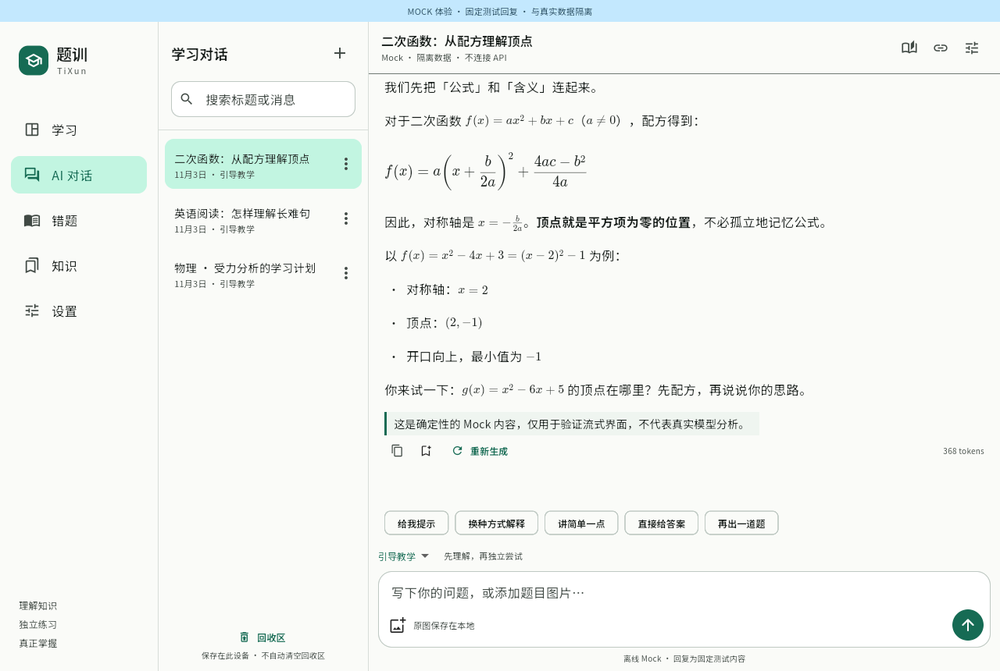
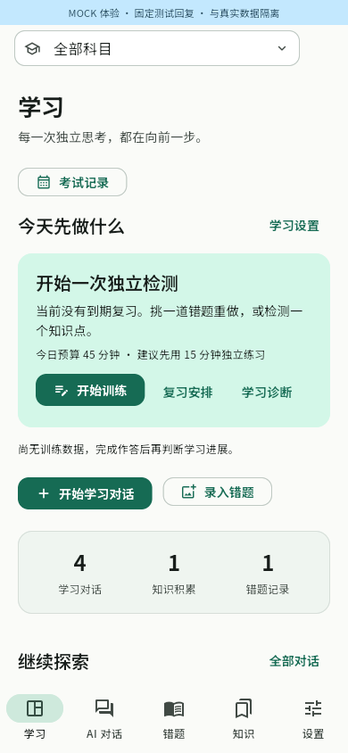
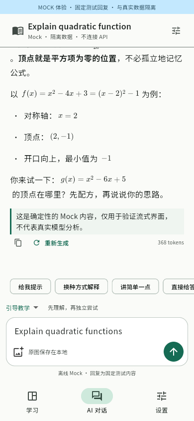
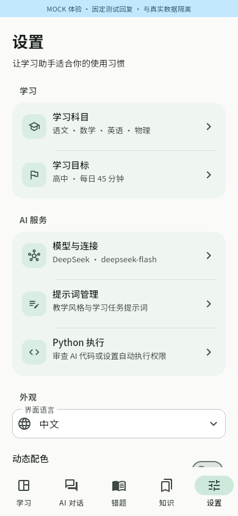
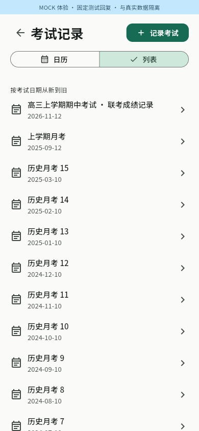

# 题训 TiXun

[English](README.en.md) · 简体中文

**把不懂的题，练到自己会做。**

题训是一款面向 Android 和 Linux 的开源学习应用。向 AI 请教，留下自己的知识笔记和错题，再通过独立作答与间隔复习，检查自己是否真正掌握。

无需注册题训账号。学习资料默认保存在设备上，已有资料和练习可以离线使用。AI 功能需要联网，使用自己的 API Key，或通过应用登录具有相应权限的 ChatGPT 账号。

[反馈问题](https://github.com/mumu-lhl/tixun/issues)

## 下载应用

- **正式版：** 下载[最新正式版](https://github.com/mumu-lhl/tixun/releases/latest)
- **想体验后续改动：** 下载[最新 Nightly](https://github.com/mumu-lhl/tixun/releases?q=nightly&expanded=true)

Linux 需要 GTK 3、bubblewrap，以及启用 unprivileged user namespaces 的内核；缺少隔离能力时 Python 会拒绝执行。保存密钥还需要已解锁的系统密钥环，例如 GNOME Keyring；不可用时会明确报错，不会改为明文保存。必要时在解压目录运行：

```bash
chmod u+x tixun
./tixun
```
## 界面预览

以下截图来自隔离 Mock 模式下的实际运行，固定回复仅用于展示界面，不代表真实模型效果。



 

 

## 反馈与参与

欢迎[提交问题或建议](https://github.com/mumu-lhl/tixun/issues)，说明平台、操作步骤与实际现象；不要公开密钥或个人学习资料。

开发相关信息见[开发指南](DEVELOPMENT.md)、[设计说明](DESIGN.md)和[当前进度](ROADMAP.md)。

代码采用 [MIT 许可证](LICENSE)，随附字体采用 OFL 许可证。
