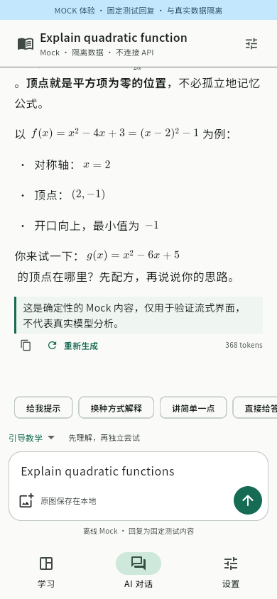
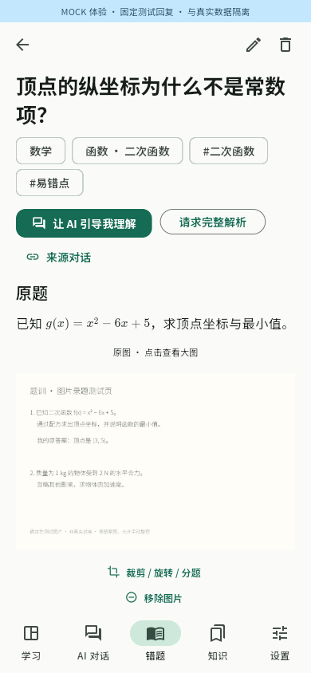

# 题训 TiXun

理解知识，独立尝试，真正掌握。面向 Android 10+ 和 Linux 的开源 Flutter 学习应用，数据默认保存在本地，无需账号。

当前为 **0.3 / M3 核心开发版**：

- AI Chat：DeepSeek / OpenAI-compatible、SSE、图片、多会话、草稿、搜索、教学模式、Markdown / LaTeX。编辑和重新生成均创建分支，保留原对话和资料来源。
- 知识库：自由正文及知识类型、科目、章节、标签、全文搜索、文本版本历史、恢复、知识关联和图片。
- 错题本：原题、原答案、个人分析、AI 解析、错误原因、知识关联、多图录入。AI 建议与用户确认的错误原因分开保存。
- 图片：原图长期保存；手动裁剪、旋转、缩小副本；框选区域可单独建立错题，保留原图和裁剪结果。已移除图片可撤销或恢复。
- Chat 资料工具：按会话授权，检索、读取、提出新增/修改/删除/关联建议；写操作逐项确认，实际操作落库并保留审计结果。并发版本检查与重复调用限制保护数据。

- 训练：Chat 内单选/多选/判断/填空/数值题、离线练习、手动录题、确定性判分、草稿/历史/提示记录、错题重做与知识回忆的自主判分、Chat 变式训练。AI 参考答案待核对，不能当作已验证的掌握证据。

**尚未实现**：AI 自动 OCR / 题目边界建议、间隔复习、学习诊断、完整备份恢复。平台与真实 API 验证状态见 [ROADMAP.md](ROADMAP.md)。

## 运行

使用 Flutter **3.47.9**（Dart 3.13.7），依赖锁定于 `pubspec.lock`。

```bash
flutter pub get --enforce-lockfile
flutter run -d linux
# 隔离 Mock：内存数据库 + 独立临时附件目录，不需要 API Key
flutter run -d linux --dart-define=TIXUN_DEMO=true
# Android 手机连接调试后
flutter run -d <设备ID>
```

Linux 系统依赖：`sudo bash scripts/install_linux_deps.sh`。保存 API Key 需要可用且已解锁的 Secret Service（例如 GNOME Keyring）；没有密钥环时不回退到明文存储，仍可浏览本地学习资料。

在设置中输入地址、模型和 API Key，测试连接会发送短消息并产生少量 API 用量。DeepSeek 默认 `https://api.deepseek.com` / `deepseek-flash`；Pro 不支持图片。自定义服务需明确声明视觉、推理参数和工具能力。

结构化出题在模型支持工具调用且关闭深度思考时可用，不授予资料检索权限。考试模式只展示工具生成的交互题，提交后揭示参考解析。

资料工具默认为关闭。在对话标题栏开启资料工具后，AI 才能检索相关资料；新增、覆盖、删除和关联均需应用内确认。当前资料工具仅在关闭深度思考时开放。也可直接通过消息菜单保存资料，不依赖工具调用。资料详情中的“向 AI 请教”会填入可检查的对话草稿，用户发送后才上传。

单次 Chat 上下文最多最近 30 条消息、32000 字符和 4 张图片；单张图片最多 8 MB。图片编辑副本最长边为 2048 像素，使用 PNG，原文件不变。资料发送优先使用每张原图最新的编辑副本。

## 验证与构建

```bash
flutter analyze
flutter test
flutter build apk --debug
flutter build linux --release
# GUI 检查必须使用隔离 Mock 构建
flutter build linux --release --dart-define=TIXUN_DEMO=true
scripts/gui_smoke.sh
xvfb-run -a dbus-run-session -- flutter test integration_test/chat_flow_test.dart -d linux --dart-define=TIXUN_DEMO=true
xvfb-run -a dbus-run-session -- flutter test integration_test/learning_materials_test.dart -d linux --dart-define=TIXUN_DEMO=true
```

Linux debug / release 共享临时引擎目录，**必须顺序构建**。截图和日志保存在 `artifacts/gui/`；脚本通过不代表视觉审查完成，仍需读取截图检查。

Golden 使用随包字体及固定环境；有意更新时运行 `flutter test --update-goldens test/ui_test.dart`，并检查图像。数据库 schema v1 → v2 迁移有保留历史数据的测试；新增字段和表时必须继续提供显式迁移。

```bash
dart run build_runner build
dart run drift_dev schema dump lib/core/database/database.dart test/fixtures
dart run drift_dev schema generate test/fixtures test/generated_migrations
```

桌面快捷键：Ctrl+1 学习、Ctrl+2 对话、Ctrl+3 设置、Ctrl+4 错题、Ctrl+5 知识；Ctrl+N 新会话，Ctrl+Enter 发送，Esc 停止。Android 使用底部导航、系统照片选择器和拍照入口；中断选择后会尝试恢复原目标。

GitHub Actions 检查代码、构建 Debug APK、构建 Linux、执行真实 GUI 集成测试及截图检查，上传 APK、Linux bundle、截图和日志；纯文档修改不触发完整构建。

## 数据与隐私

数据库与附件位于 `path_provider` 的应用支持目录下 `tixun/`。API Key 按服务商与地址存放于系统安全存储，不进入数据库、日志或源码。无第三方应用分析与遥测。工具读取有范围和长度限制，不上传整个知识库；图片不经检索工具自动上传。Markdown 外部图片不自动联网加载。

知识、错题、会话及图片删除均可恢复，不自动清空。知识历史目前覆盖文本和标签，图片通过独立的移除/恢复机制管理。完整备份仍未实现；卸载前关闭应用，保留完整数据目录及附件，勿仅复制打开状态的 SQLite 主文件。

架构见 [DESIGN.md](DESIGN.md)，进度见 [ROADMAP.md](ROADMAP.md)。代码 MIT，字体 OFL。

## 界面

以下为隔离 Mock 构建的真实 Linux GUI 截图，回复为固定测试数据。







当前 M2 验证构建：[Android APK、Linux bundle 与测试截图](https://github.com/mumu-lhl/tixun/actions/runs/41680879458)。
