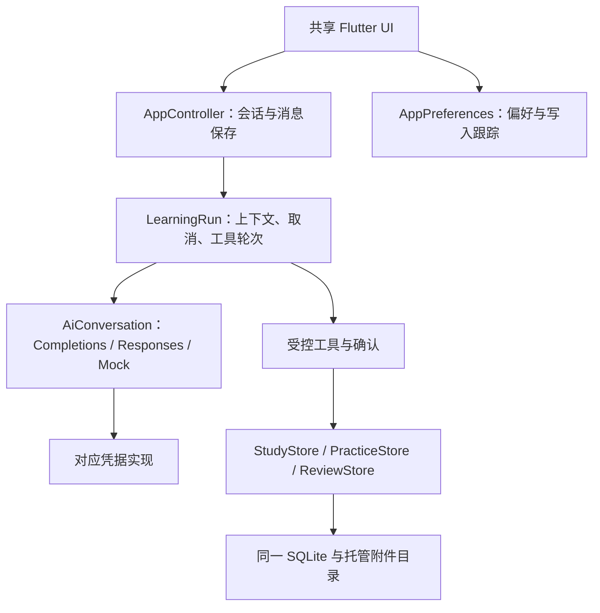

# 架构调整与接口约定

当前说明更新于 2026-11-10。沿用 Flutter、Riverpod、go_router、Drift 和本地附件目录；数据库已演进至 schema v17，通过显式迁移保留旧学习数据。下方接口约定继续适用，末尾保留早期调整的历史验收记录。

## 当前职责

| Module | Interface 与行为 |
| --- | --- |
| `core/ai/ai_types.dart` | `AiRequest`、`AiMessage`、`AiTool`、完整 `ToolCall` 与 `AiChunk`。`ChatProvider.start` 创建单次 `AiConversation`，同一运行内顺序完成工具轮次。调用方不传厂商请求 Map，也不收集厂商工具片段。 |
| `core/ai/chat_provider.dart`、`chatgpt/responses.dart` | Chat Completions、Responses 与 Mock 三个 Adapter。各自编码 HTTP、解析流、处理完整工具调用。API Key 在实现内部读取；未保存的密钥只允许配置页连接测试显式覆盖。Responses 加密推理上下文属于当前 Conversation，不写入 AiRequest 或消息历史。 |
| `core/ai/context_compactor.dart`、`token_estimator.dart` | 上下文预算估算、旧对话摘要及覆盖位置；失败可降级，原始消息保留。不是固定条数截断，也不冒充精确 tokenizer。 |
| `core/ai/ai_options.dart` | 统一配置校验、会话思考覆盖、图片能力、思考与工具兼容性，以及实际发送的强度参数。DeepSeek 可显式关闭思考；其他兼容路线省略强度参数表示模型默认，界面按该语义显示。 |
| `features/chat/learning_run.dart` | 学习上下文、教学提示、用量汇总、三分钟超时、四轮/八次工具上限、结束判定和受控工具执行。通过进度与结果返回给调用方；考试过程中不会把原始模型答案当进度发布。 |
| `app/controller.dart` | 保留页面状态、会话/草稿、附件入口与任务准备；负责创建回复记录、节流保存进度、保存最终状态。委托 LearningRun 执行推理，不了解 tool_calls、finish_reason 或 Responses 私有字段。 |
| `app/preferences.dart` | 语言、主题、配色、提示词与 Provider 配置。拥有独立写入跟踪；关闭、备份导出及恢复等待必要写入，不再借用 StudyStore 的空闲状态。现有控制器方法保留为 UI 的兼容入口。 |
| `core/ai/chatgpt/auth.dart` | 只向 UI 返回只读账号摘要和一次取得的账号快照；令牌记录、HTTP 与安全存储细节留在实现内部。保留 PKCE/JWT 校验、合并刷新、取消等待、退出与原子保存语义。 |
| `features/update/` | 发布通道、版本与 ABI 选择、下载校验、Android 系统安装和 Linux 重启切换，学习数据与程序目录隔离。 |
| `StudyStore` / `PracticeStore` | 分题接收的文件写入、事务和幂等操作集中于 `acceptQuestionRegion`；题目修订及继承关联集中于 `revise`。UI 不再自行组合这些写入。 |
| `core/visual/*`、`features/visual/*`、`core/ai/visual_tool.dart` | Visual DSL v1：场景验证、采样、渲染、存储与三个图形工具。`create_visual` / `update_visual` / `get_visual` 只在非考试模式提供；出题用 `visual_id` + `visual_revision` 钉住不可变快照。 |

应用根部和导航通过 Riverpod select 订阅实际使用的偏好与提示，聊天流式通知不再因读取语言/配色而重建整个应用根部。尚未用 Android 实机数据量化帧耗时，不声称已有性能基准结果。

## 数据流

## 必须保持的约定

- 每个学习请求独立创建 Conversation，在该请求内顺序调用。Opaque 推理状态不跨运行共享、不进入数据库或备份。
- 工具调用仅可出现在明确完成的事件中。没有完成事件、重复结束或不完整调用均不得触发写入。流式片段的拼接与格式校验属于对应 Adapter。
- `AiChunk.tokens` 是本轮累计用量，后续值覆盖此前估计；LearningRun 再汇总不同工具轮次。端点不支持的输出限制不强行发送。
- 停止生成不取消其他等待者共用的 OAuth 刷新；退出先失效本机令牌，后台刷新不能使其重新生效。
- 数据恢复继续复用原 KeyStore 和 Provider，授权运行状态不随数据库替换重新创建。
- 作答与复习仍在同一事务内提交，Store 的通知保持原 Zone 约定；不改为不保证顺序的后台事件。
- 资料写入仍逐项确认；模型输出、资料内容和用户自定义提示词都不能提升工具权限。
- 图形工具只读写 Visual DSL 场景 JSON，不执行模型生成的代码；出题钉住的快照版本不受后续编辑影响。
- 原图、裁剪、修订、历史作答、迁移和备份恢复能力保留。

## 维护与验证

旧有行为测试已适配新 Interface，并增加 `test/architecture_test.dart`：能力矩阵、只读账号快照、偏好关闭屏障、修订继承关联、未完成响应禁止写入、考试答案隐藏、调用上限、用量与取消。协议细节继续通过实际编码/解码及隔离 HTTP 测试验证，原生 GUI 流程继续覆盖聊天、训练、备份与设置。

AppController 仍是现有 UI 的协调入口，没有强行把每个动作拆成 UseCase。少量简单只读 SQL 查询仍留在页面或 Riverpod 查询中；后续出现实际重复或修改关联规则时再收拢。暂不增加分层模板、独立向量库、服务器或完整状态管理重写。

历史验收（2026-11-07）：提交 `a6ea5eb` 的[完整 CI](https://github.com/mumu-lhl/tixun/actions/runs/42376246976)已通过：静态分析、90 项 Flutter 测试、16 项脚本测试、Android Debug APK、Linux Release、Mock 启动与七组原生 GUI 回归（九个测试场景）。本地还运行了生产版 Linux GUI，并读取了主页、ChatGPT 设置、提示词编辑和备份恢复截图。真实订阅账号推理与 Android 实机验证仍需对应账号和设备，Mock/协议测试不代替这两项验证。

当前功能和待验收项以 [ROADMAP](../ROADMAP.md) 为准。路由内的 Material 表面隔离点击波纹；图片查看共用 `image_viewer.dart`，裁剪共用 `StudyImageEditor`；相机保留 WeChat 拍摄界面，选用 Camera2 后端，并提供系统相机替代入口。未新增通用媒体工作流或多层数据映射。
